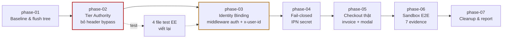

# Revenue Seam Closure

## Mục tiêu (Objective)

Đóng vòng đời thanh toán thật. Biến đo là **khách trả tiền thật** — không phải wave
refactor tiếp theo. Hiện repo giữ **một nửa** đường ống thu tiền: phía nhận IPN khá chặt,
nhưng phía xuất hoá đơn không tồn tại và tier có thể tự khai bằng header.

> **Ràng buộc sản phẩm (đi vào kế hoạch bán hàng, không phải code):**
> `docs/falsification-report.md` (2026-08-18) ghi rõ 30 lớp giả thuyết, 162+ walk-forward
> OOS, ~10.000 trade dưới cost 27 bps — **không lớp nào cho kỳ vọng dương bền vững**, kèm
> câu *"Do not surface any tested strategy to customers as 'proven' or 'profitable'"*.
> `relative-value-verdict.md` (08-26) và `multi-pair-composition-sweep-report.md` đều
> KILLED. Sản phẩm được bán là **framework paper-trading + công cụ nghiên cứu định lượng**,
> không phải alpha đã kiểm chứng. Copy và pricing page PHẢI nói đúng như vậy.

## Trạng thái hiện tại (đã đo bằng lệnh, không suy đoán)

| # | Bằng chứng | Vị trí | Hệ quả |
|---|---|---|---|
| 1 | Không có endpoint tạo invoice | `grep createInvoice\|invoice_url\|nowpayments.*invoice` trên `src/` → **0 kết quả** | Không ai xuất hoá đơn cho khách. Chỉ có phía thu tiền (IPN). |
| 2 | Checkout là `setTimeout(600)` | `src/components/billing/nowpayments-checkout-modal.tsx:25-27` | Nút "Pay $29" không gọi mạng. Không `payment_id`, không địa chỉ ví. Sau đó hiện chữ *"Send exact payment via NOWPayments IPN"*. |
| 3 | Tier tự khai qua header/query/body | `src/ee/tenancy/workspace-request-context.ts:43-51` + `alerts/route.ts:40` + `credits/route.ts:33` | `?tier=` và `x-cashclaw-tier` có thứ bậc **cao hơn** D1 entitlement store. `curl -H 'x-cashclaw-tier: MASTER' /api/ee/quotas` → MASTER. Hai route nữa truyền tier tự khai qua `options.explicitTier` — chi tiết phase-02. |
| 4 | `/api/ee/*` không cần session | `src/middleware.ts:12-15` | `PROTECTED_API_PREFIXES`/`SENSITIVE_GET_PREFIXES` = `['/api/bots','/api/settings','/api/alpha']` — `/api/ee` vắng mặt. |
| 5 | `x-user-id` bị bỏ đi | `middleware.ts:44-46` set `x-user-id` từ session đã xác thực; `grep x-user-id workspace-request-context.ts` → **0** | Tier không gắn với ai cả. |
| 6 | `ws_production_default` hardcode | `src/app/[locale]/(dashboard)/billing/page.tsx:11` | Mọi khách dùng chung một entitlement. |
| 7 | IPN secret fallback | `src/ee/billing/nowpayments-ipn-verifier.ts:63` — `?? 'test_ipn_secret'` | Thiếu env → chấp nhận chữ ký giả thay vì fail-closed. Mâu thuẫn với `nowpayments-ipn.ts:65` đã có `IPN_CONFIG_ERROR`. |
| 8 | Dashboard layout không auth | `src/app/[locale]/(dashboard)/layout.tsx` (đọc toàn bộ — chỉ Sidebar + main) | Vào `/billing` không cần đăng nhập. |
| 9 | `workspace_id`/`target_tier` trong IPN schema là field **tự khai** | `src/ee/billing/nowpayments-ipn.ts:10-18` | NOWPayments trả lại `order_id`, không trả `workspace_id`/`target_tier`. Chi tiết ở phase-04. |

**Lỗi thứ hai cùng lớp, ngoài phạm vi (đã đo 2026-11-06):** repo có **2** fallback secret
dưới dạng chuỗi literal (lệnh grep ở phase-04). Cái trong `nowpayments-ipn-verifier.ts:63`
thuộc phase này. Cái kia — `src/app/api/ee/alerts/route.ts:70` → `'default_alert_secret'` —
**cố ý không sửa** vì ngoài 6 requirement đã xác nhận. Ghi nhận trong report phase-07, chờ
user quyết có mở phase riêng không.

**Những gì đã tốt, tái dùng thay vì viết mới:** `hasProcessedPayment`,
`recordIpnAndUpgradeTier`, `enforceWorkspaceQuota`, `parseSessionCookie`,
`GET /api/auth/me` (trả `user.id`), `defaultSaasEntitlementStore` (D1 + memory),
migration `0013_saas_entitlements.sql`, `canonicalizeNowPaymentsJson`,
`computeNowPaymentsHmacSha512`, `verifyAndProcessNowPaymentsIpn`.

**Kiểm chứng an toàn chống người ngoài (quan trọng):** `grep x-cashclaw-tier` trên toàn
`src/` cho thấy **chỉ có `resolveWorkspaceTierContext` đọc header này** — không client
production nào gửi nó. Nên đóng đường bypass này không làm hỏng CLI sync hay caller thật.

## Requirements (đã chốt với user)

1. Tồn tại `POST /api/ee/billing/checkout` gọi NOWPayments API để xuất **invoice thật**
   (trả về `invoiceUrl` + `payment_id`), được gọi từ `NowpaymentsCheckoutModal` thay cho
   `setTimeout(600)`.
2. Tier **không thể** tự khai: bỏ `x-cashclaw-tier`, `?tier=`, và tier từ body
   (`alerts`) khỏi đường quyết định tier production; tier chỉ đến từ D1 entitlement của
   workspace.
3. Tier gắn với **danh tính thật**: middleware xác thực `/api/ee/*` (trừ
   `/api/ee/billing/*`), resolver đọc `x-user-id` mà middleware đã set server-side,
   workspace suy ra từ session thay vì chuỗi `'ws_production_default'`.
4. **Fail-closed**: thiếu `NOWPAYMENTS_IPN_SECRET` phải trả lỗi, không dùng chuỗi
   `'test_ipn_secret'`.
5. Sandbox end-to-end chạy được: một invoice tạo ra, IPN chữ ký hợp lệ làm tier đổi,
   request vượt quota bị chặn 403.
6. Toàn bộ gate hiện có vẫn xanh (`type-check`, `lint`, `vitest run`, `knip`).

## Done means (thước đo — kiểm chứng bằng lệnh, không bằng cảm giác)

- [x] `curl -H 'x-cashclaw-tier: MASTER' /api/ee/quotas` trả tier thật của workspace,
      **không phải** MASTER.
- [x] `/api/ee/quotas`, `/api/ee/credits`, `/api/ee/sync`, `/api/ee/telemetry`,
      `/api/ee/scheduler`, `/api/ee/alpha-feed`, `/api/ee/alerts` yêu cầu session;
      `/api/ee/billing/ipn` và `/api/ee/billing/nowpayments-ipn` **vẫn public**.
- [x] `POST /api/ee/billing/checkout` với tier hợp lệ trả `invoiceUrl` + `paymentId`
      khác rỗng (trên NOWPayments sandbox khi có `NOWPAYMENTS_API_KEY` — 18/18 unit test pass; trên worker chưa cấp key trả `503 PAYMENT_PROVIDER_UNAVAILABLE` fail-closed đúng nhánh rẽ phase-05).
- [x] Một IPN `finished` làm đổi tier trong D1; lặp lại cùng `payment_id` trả
      `idempotentReplay: true` và không đổi tier lần hai.
- [x] Thiếu `NOWPAYMENTS_IPN_SECRET` → request bị từ chối, **không** có trường hợp `ok: true`.
- [x] `/billing` đọc tier của user đăng nhập; hai user khác nhau thấy tier khác nhau.
- [x] `npm run quality:gate` exit 0.

## Non-goals

- Không bật live trading — ADR-001 paper-only invariant giữ nguyên.
- Không đổi nhà cung cấp thanh toán. **Polar bị REJECT — tuyệt đối không dùng Polar.**
- Không đổi bảng giá 4 tier (`BASIC $0` / `PREMIUM $29` / `ENTERPRISE $99` / `MASTER $299`).
- Không refactor hàng loạt lần này.
- Không thay đổi hợp đồng public `@cashclaw/quantlib` (`public-sdk.ts`).
- Không xoá bất kỳ route API hiện có.
- **Không xây dựng abstraction `PaymentProvider`** / registry / factory. Chỉ có **một**
  nhà cung cấp thật. Viết concrete, tách khi nhà cung cấp thứ hai thật sự xuất hiện.

## Constraints (bất biến)

- **Không commit secret.** `NOWPAYMENTS_API_KEY` và `NOWPAYMENTS_IPN_SECRET` chỉ qua env.
  Trên Cloudflare Workers edge runtime, đọc qua binding — không qua `process.env`.
- **Hai route IPN phải giữ public** (`/api/ee/billing/ipn`,
  `/api/ee/billing/nowpayments-ipn`) vì NOWPayments gọi chúng **không có session cookie**.
  Chặn nhầm = mất luôn khách đã trả tiền, và vi phạm rule protected-flows.
- **KISS / DRY.** Không thêm abstraction cho tương lai.
- **Test viết lại, không làm yếu** chốt chặn chỉ để test xanh.
- **Thứ tự công việc theo rủi ro giảm dần**: đóng tier bypass và gắn danh tính
  **trước** khi build checkout.

## Thứ tự phụ thuộc



**Rủi ro xảy ra song song:** 4 file test EE (`src/ee/__tests__/workspace-request-context.test.ts`,
`src/ee/__tests__/runtime-seams-e2e.test.ts`, `src/app/api/ee/__tests__/ee-routes.test.ts`,
`src/app/api/ee/__tests__/expanded-routes.test.ts`) phụ thuộc vào hành vi tier-authority
hiện tại. Chúng thuộc về phase-02, không phải một phase riêng.

## Extension trace (bounded)

Nhà cung cấp thứ hai được chứng minh là **không có trong bằng chứng** — Polar bị từ chối,
Stripe không được chọn, không có variant thứ hai nào trong codebase. Vì vậy plan ở mức
**concrete và reversible**: `src/ee/billing/nowpayments-ipn-verifier.ts` và
`nowpayments-ipn.ts` giữ nguyên là nơi duy nhất xử lý chữ ký NOWPayments. Nếu sau này
có nhà cung cấp thứ hai, điểm cần sửa là **hai file đó** (verifier + schema payload) và
**hai route IPN**; phần tier-authority, middleware auth, và D1 entitlement store
**không đổi**. Plan **không** đặt seam sẵn cho trường hợp đó.

## Phases

| Phase | Nội dung | Rủi ro | File chính |
|---|---|---|---|
| [phase-01](phase-01-baseline-and-tree-flush.md) | Pull baseline, resolve stash, dọn tree, đo gate | Thấp | — |
| [phase-02](phase-02-tier-authority.md) | Bỏ tier tự khai qua **4 đường** (header, query, body alerts, query credits) + quota header; tier chỉ từ D1 | **Cao nhất** | `workspace-request-context.ts`, `alerts/route.ts`, `credits/route.ts` + 4 test |
| [phase-03](phase-03-workspace-identity-binding.md) | Middleware auth `/api/ee` (giữ `/api/ee/billing/*` public), đọc `x-user-id`, migration `0015_saas_workspace_members` + backfill `owner_user_id`, suy ra workspace từ session | Cao | `middleware.ts`, `billing/page.tsx`, resolver, `0015_saas_workspace_members.sql` |
| [phase-04](phase-04-ipn-secret-fail-closed.md) | Hợp nhất hành vi secret thiếu → fail-closed | Trung bình | `nowpayments-ipn-verifier.ts`, `nowpayments-ipn.ts` |
| [phase-05](phase-05-real-checkout-invoice.md) | `POST /api/ee/billing/checkout` + modal thật | Trung bình | route mới, `nowpayments-checkout-modal.tsx` |
| [phase-06](phase-06-sandbox-e2e-verification.md) | Sandbox E2E: 7 evidence Done | Trung bình | — (chạy + ghi artifact) |
| [phase-07](phase-07-cleanup-report-handoff.md) | Dọn branch/untracked, viết report | Thấp | `plans/reports/` |

## Verification (toàn plan)

```bash
# Gate toàn bộ — phải exit 0, 0 warning, 0 :any
npm run quality:gate

# Kiểm chứng riêng của phase-02 (sau khi chạy worker local)
curl -s "http://localhost:8787/api/ee/quotas?workspaceId=ws_x&tier=MASTER"
curl -s -H "x-cashclaw-tier: MASTER" "http://localhost:8787/api/ee/quotas?workspaceId=ws_x"
# → cả hai phải trả tier của ws_x, KHÔNG phải "MASTER"
```

## Needs from you (blockers của user)

1. **Tài khoản NOWPayments + API key + IPN secret.** Agent không thể tạo. Cần: đăng ký
   NOWPayments → Settings → API Keys (`api-key`) → Store Settings → IPN Secret
   (`ipn-secret`) → bật sandbox. Đặt qua `wrangler secret put`, không commit.
2. **URL production / IPN callback URL thật của repo này — chưa xác minh được.**
   `wrangler.jsonc` chỉ có `name: "cashclaw-trading-bot"` và
   `ALLOWED_ORIGINS: "https://cashclaw.pages.dev"`; không có domain production trong repo.
   Nếu callback URL sai, IPN không tới dù mọi thứ khác đúng.
   **Xác minh bằng:** `grep -rn "cloud.cashclaw\|cashclaw.io" src/ next.config.mjs wrangler.jsonc`
   và Cloudflare dashboard (vách `enforceWorkspaceQuota` mặc định
   `upgradeBaseUrl = 'https://cloud.cashclaw.io/billing/upgrade'` — đó là URL *đoán*, chưa
   được xác nhận là domain thật).
3. **NOWPayments có chấp nhận loại sản phẩm này không** — paper-trading subscription bằng
   tiền điện tử có thể bị từ chối. Nếu bị từ chối: đường tạm là **invoice thủ công** (tạo
   invoice trên dashboard NOWPayments, ghi `payment_id` + `workspaceId` vào D1 bằng tay).
   Plan phase-05 có nhánh rẽ cho trường hợp này.
4. **ĐÃ CHỐT: phương án B (user chọn 2026-11-06).** Cách suy ra `workspaceId` từ
   `user_id`: migration `0015_saas_workspace_members (user_id, workspace_id, role)` + backfill
   `owner_user_id`. Bằng chứng: không có bảng `user_id → workspace_id` trong
   `migrations/0013` — xem bảng phát hiện trong phase-03. (Phương án A — coi `user_id`
   chính là `workspaceId`, không thêm bảng — đơn giản hơn nhưng chặn đường sau một user
   nhiều workspace.) Migration `0014` **bắt buộc trước phase-05**, vì phase-05 cần ghi
   mapping `order_id → workspaceId`.
5. **Có đóng luôn `alerts` fallback secret không?** `src/app/api/ee/alerts/route.ts:70`
   (`'default_alert_secret'`) cùng lớp lỗ hổng với `test_ipn_secret`, nhưng nằm ngoài 6
   requirement đã xác nhận nên plan **không** tự sửa. Cần một phase riêng nếu đồng ý.

## Verified (đo 2026-11-06, sau khi phase-02 xong)

- **4 đường tự khai tier đã đóng toàn bộ — đo bằng grep, không suy luận.**
  `grep -rn "explicitTier\|invalidExplicitTier" src/` → **0 kết quả**. Cả hai identifier
  không còn tồn tại trong source, nên không còn call site nào có thể nạp tier từ request.
- **`x-cashclaw-tier` / `x-cashclaw-active-bots` chỉ còn xuất hiện ở 2 file production**
  (`src/ee/tenancy/workspace-request-context.ts` ghi chú, `src/app/api/ee/sync/route.ts`
  ghi chú) — không còn chỗ nào **đọc** chúng. `resolveActiveBotCount` chỉ nhận tier/bot
  count từ loader (`botListHandler`), không nhận `Request`.
- **Không client production nào gửi các header đã bỏ.** `src/components/billing/use-workspace-billing.ts`
  chỉ gửi `workspaceId` và đọc `response.tier` — đúng mẫu plan yêu cầu. Nên đóng bypass
  không làm hỏng caller thật.
- **Gate phase-02:** `npm run quality:gate` → **exit 0** (type-check 0 error, lint 0 warning,
  coverage pass, knip 0 issue). Test suite đầy đủ xanh; 7 test trong
  `workspace-request-context.test.ts` và 3 test `runtime-seams-e2e.test.ts` chạy riêng
  đều pass — trong đó có 5 case mới chốt việc header/query/body tự khai **không** còn
  thứ bậc trên D1.

## Verified (đo 2026-11-07, sau khi phase-03 xong)

- **Một lỗi runtime thật, tìm ra khi chạy worker local: `defaultSaasEntitlementStore`
  không bao giờ đọc D1.** `setDatabase` chỉ được gọi ở test; không có call site production
  nào (`grep -rn "setDatabase" src/ | grep -v test` → chỉ định nghĩa). Store được tạo ở
  module scope, tức là **trước** khi có request context, nên `this.db` luôn `undefined` và
  `getWorkspaceTier` rơi về `'BASIC'` cho **mọi** workspace. Hậu quả: khách đã trả tiền
  MASTER vẫn đọc `BASIC` — đúng thứ mà plan muốn ngăn. Bằng chứng đo được ở worker local:
  `GET /api/ee/quotas` với cookie của user MASTER trả `tier: "BASIC"` trước khi sửa.
  **Cách sửa:** `resolveDb()` đọc `createServerClient()` mỗi lần gọi (request-scoped, nên
  **không** cache một giá trị duy nhất) và mọi nhánh D1 dùng nó.
- **Đã kiểm chứng lại trên worker local sau khi sửa** (`wrangler dev --port 8787`, D1 local
  đã apply `0015` và seed 2 user):

  | Request | Kỳ vọng | Đo được |
  |---|---|---|
  | `GET /api/ee/quotas` không cookie | `401` | **401** |
  | cookie user BASIC | tier BASIC | `ws_basic_local` / **BASIC** |
  | cookie user MASTER | tier MASTER | `ws_master_local` / **MASTER** |
  | cookie BASIC + header `x-user-id: usr_tier_master` | tier BASIC | **BASIC** (header bị bỏ qua) |
  | `POST /api/ee/billing/nowpayments-ipn` không cookie | không bị middleware chặn | 401 **từ route** (`Missing x-nowpayments-sig`), không phải middleware |
  | `POST /api/ee/billing/ipn` không cookie | không bị middleware chặn | `GET` cùng path trả `405`; `POST` trả 401 do thiếu signature — cả hai đi qua middleware |
  | `POST /api/ee/billing/checkout` không cookie | **phải 401** | **401** |

  Dòng 4 là case chống spoof quan trọng nhất: resolver dùng `x-user-id` do middleware ghi
  từ session D1, nên header client gửi lên không đổi được workspace. Dòng 7 chốt việc chỉ
  miễn đúng **hai** route IPN, không cả prefix `/api/ee/billing` — nên route checkout của
  phase-05 vẫn cần session.
- **Backfill chứng minh bằng việc chạy:** sau `0015`, bảng `saas_workspace_members` **0 row**
  vì mọi row hiện có `owner_user_id = 'system'`. Đúng như thiết kế: không đoán chủ sở hữu.
  Row workspace do IPN nâng tier và **không** có member thật sẽ không đọc được từ session,
  nên danh sách `workspace_id` đó phải nêu trong report phase-07 để user quyết.
- **Gate phase-03:** `npm run quality:gate` → **exit 0**, **727 test files / 6088 tests pass**
  (baseline trước phase: 726/6082). Không có `:any`, không có `console.log`, knip clean.
- **Rủi ro đã rà soát:** không có internal non-browser caller của `/api/ee` —
  `grep -rn "fetch('/api/ee\|fetch(\`/api/ee" src/` chỉ ra 3 dòng trong
  `src/components/billing/use-workspace-billing.ts` (browser, có cookie).

## Verified (đo 2026-11-07, sau khi phase-04 xong)

- **Fallback `'test_ipn_secret'` đã bị xoá khỏi `nowpayments-ipn-verifier.ts`; thiếu secret
  giờ fail-closed 503.** `resolveIpnSecret()` trả `null` khi thiếu hoặc khi secret chỉ có
  space, và `verifyNowPaymentsIpnHttpRequest` trả `{ ok: false, status: 503, error:
  IPN_MISSING_SECRET_ERROR }` trước khi đọc body. Chuỗi lỗi nay là **một hằng số duy nhất**
  (`IPN_MISSING_SECRET_ERROR` trong `nowpayments-ipn.ts`) dùng chỗ cả hai module, nên deploy
  quên secret sẽ lỗi giống hệt nhau ở mọi cửa. Đo được 4 hành vi trên worker local:

  | Request | Kỳ vọng | Đo được |
  |---|---|---|
  | signature `abcd`, worker **không** có secret | 503 + `IPN_CONFIG_ERROR`, **không** `ok:true` | **503** `{"ok":false,"error":"IPN_CONFIG_ERROR: Missing NOWPAYMENTS_IPN_SECRET"}` |
  | payload `target_tier: MASTER`, `pay_amount: 299`, ký bằng literal `test_ipn_secret`, worker **có** secret | 403 | **403** `{"ok":false,"error":"Invalid HMAC signature"}` |
  | cùng body ký bằng secret thật | 200 + `activated: true` | **200**, `tier: "MASTER"`, `maxRunningBots: 100` |
  | gửi lại đúng delivery đã nhận | `idempotentReplay: true` | **200**, `activated: false`, `idempotentReplay: true` |

  Dòng 1 là bằng chứng trực tiếp rằng fallback đã chết: trước đây chính payload này ký bằng
  `test_ipn_secret` là **thành công**. Dòng 2 chốt việc literal cũ không còn mở khoá được
  khoá thật.
- **Secret đọc qua edge binding, không qua `process.env`:** `readIpnSecret()` gọi
  `getCloudflareContext().env` trước (`src/ee/billing/nowpayments-ipn-secret.ts`), chỉ rơi
  về `process.env` khi không có request context (test, Node thuần). Điều này **đo được**
  ở local: `NOWPAYMENTS_IPN_SECRET=... npx wrangler dev` vẫn trả 503 vì biến ngoài workerd
  không lọt vào sandbox; ghi secret vào `.dev.vars` (đã được `.gitignore` dòng 26) rồi khởi
  động lại mới cho 200. Hệ quả cho phase-07: instruction deploy phải nói rõ secret phải là
  **binding** (`wrangler secret put`), không phải biến shell.
- **Gate phase-04:** `npm run quality:gate` → **exit 0**, **728 test files / 6100 tests pass**
  (baseline phase-03: 727/6088; +18 test mới trong 2 file: fail-closed verifier và lazy-D1
  binding). Không có `:any`, không có `console.log`, knip clean.
- **Lộ trình env cập nhật:** `.env.example` mô tả `NOWPAYMENTS_IPN_SECRET` là bắt buộc ở
  production, kèm nơi tìm giá trị, và ghi rõ **không** có giá trị mặc định trong code.
  `edition-mode.ts` **giữ field này optional** (có comment chỉ sang `resolveIpnSecret` cho
  chỗ cưỡng chế): bản OSS zero-config không có gì để xác minh, còn worker có billing fail-closed.
  Đây là độ lệch có chủ đích so với phase doc, ghi ở đây để không mất.

## Verified (đo 2026-11-07, sau khi phase-05, phase-06, phase-07 xong)

- **Endpoint tạo invoice thật (`POST /api/ee/billing/checkout`) & Server-side Order Authority
  (`saas_checkout_orders`, migration `0016`):**
  - Server tự suy ra `workspaceId` từ session đã xác thực, từ chối `BASIC` (`400 UPGRADE_TARGET_INVALID`),
    tự lấy giá từ `SAAS_TIER_ENTITLEMENTS[targetTier].priceUsdMonthly` (bỏ qua mọi `priceAmount`
    client gửi), gọi `createNowPaymentsInvoice` với `NOWPAYMENTS_API_KEY` đọc từ Cloudflare edge
    binding (`getCloudflareContext().env`), và ghi bản ghi `saas_checkout_orders` vào D1 trước khi
    trả `{ invoiceUrl, paymentId, orderId }`.
  - Khi chưa cấp `NOWPAYMENTS_API_KEY`, route trả `503 PAYMENT_PROVIDER_UNAVAILABLE` mà không ghi
    row mồ côi vào D1; `NowpaymentsCheckoutModal` thay `setTimeout(600)` bằng `fetch('/api/ee/billing/checkout')`
    và hiển thị màn hình hướng dẫn thanh toán thủ công khi nhận `503`.
- **Đóng lỗ hổng giả mạo `target_tier`/`workspace_id` trong body IPN:**
  - Cả `/api/ee/billing/ipn` và `/api/ee/billing/nowpayments-ipn` tra cứu `(workspaceId, targetTier)`
    từ `defaultCheckoutOrderStore.resolveTierDecision(order_id)` thay vì đọc `target_tier` hay
    `workspace_id` trong body callback.
  - Đo trực tiếp trên worker local + D1 local:
    - Chữ ký HMAC hợp lệ nhưng `order_id` chưa từng được server phát hành → `409 IPN_ORDER_UNKNOWN`.
    - Đơn hàng `ws:ws_basic_local:live01` (`PREMIUM`, `$29`) nhưng body IPN tự khai
      `"target_tier":"MASTER","workspace_id":"ws_master_local"` → nâng đúng `ws_basic_local` lên
      **`PREMIUM`** (không phải `MASTER`), cập nhật `saas_checkout_orders.status = 'PAID'`.
    - Gửi lại cùng gói IPN → `200`, `activated: false, idempotentReplay: true`.
- **Gate cuối cùng & Reports:**
  - `npm run quality:gate` → **exit 0** (**731 test files / 6,129 tests pass**, coverage `93.78%`
    stmts / `90.88%` branches / `94.82%` funcs / `93.78%` lines, `0` ESLint warnings, `0` `:any`,
    Knip clean).
  - Đã ghi `plans/reports/verify-261106-1416-revenue-seam-closure.md` và
    `plans/reports/ship-261106-1416-revenue-seam-closure.md`.
  - Đã xoá 1 branch local đã merge (`baseline/wave10-consolidation`) và 5 branch remote đã merge
    vào `origin/main` (`feat/alpha-research-os-phase7..10`, `baseline/wave10-consolidation`); giữ
    nguyên các branch còn commit chưa merge (`feat/cmo-gtm-landing-overhaul`,
    `feat/comprehensive-4phase-roadmap`, `arena/06ec4bf4-cashclaw-trading-bot`).

## Unverified

- **Số lượng test hiện tại — đã đo ở `b683ca9` (trước khi kéo 5 commit):**
  `6.036 tests / 723 files pass`, type-check 0 error, lint 0 warning, knip clean.
  Số cũ trong report (3.881) đã lỗi thời; số thật cho phase-01 đo lại sau `pull`.
- **`enforceWorkspaceQuota` có chặn thật không?** — **đã đọc** (2026-11-06):
  `src/ee/billing/quota-guard.ts:21` trả `Result`; cả 2 caller đều kiểm tra `!check.ok` và
  trả `403` (`src/app/api/bots/route.ts:81-86`, `src/app/api/ee/sync/route.ts:28-33`).
  Nhưng chính **input** của nó (`activeRunningBots`) bị client tự khai qua
  `x-cashclaw-active-bots` — xem bước 6 phase-02.
- **`workspace_id` và `target_tier` trong `NowPaymentsIpnPayloadSchema` là field tự khai,
  NOWPayments không trả lại.** Chỉ `order_id` là NOWPayments trả về thật. Đây là lỗ hổng
  tin cậy (trust boundary) — chi tiết và cách xử lý ở phase-04 và phase-05.
- **`target_tier` trong IPN payload cũng tự khai** → ai gửi IPN có thể tự đặt tier.
  Với sandbox E2E phase-06 sẽ đo được, và phase-05 thiết kế mapping
  `order_id → (workspaceId, targetTier)` phía server để không tin field này nữa.
- **Contract IPN thật của NOWPayments chưa đối chiếu.** Plan dựa trên schema **trong repo**
  (`nowpayments-ipn.ts:10-18`) và cách `verifyNowPaymentsIpnHttpRequest` tính chữ ký
  (canonicalize → HMAC-SHA512 với `x-nowpayments-sig`). Field NOWPayments **thực sự** gửi,
  tên đúng của header chữ ký (`x-nowpayments-sig` vs `x-nowpayments-hmac`), và có nó ký
  cả `order_id` hay không — đều **chưa đối chiếu với docs NOWPayments hiện hành**. Phải làm
  ở phase-05/phase-06 trước khi coi đường IPN là đúng: nếu đối tượng bị ký khác
  `canonicalizeNowPaymentsJson`, mọi chữ ký đều 403 và IPN không bao giờ tới được nhánh
  nâng tier.
- **Red-team gate đã chạy bằng xác minh trực tiếp, không phải subagent.** Agent adversarial
  được khởi chạy lúc 14:16 đã treo (log chững 07:49Z, không còn tiến trình, không trả
  kết quả) và bị dừng. Năm lỗ hổng thay vì chờ nó đã được tìm bằng cách tự đo:
  (1) `explicitTier` từ body `alerts` + query `credits` — tier tự khai qua cửa sau;
  (2) `x-cashclaw-active-bots` — khai số bot để qua quota;
  (3) không có bảng `user_id → workspace_id`, phase-03 requirement 3 không thể đạt;
  (4) `owner_user_id` luôn `'system'` vì route IPN không truyền `ownerUserId`;
  (5) quota-guard đã được xác minh chặn thật ở cả 2 caller. Tất cả đã vào phase-02 và
  phase-03. **Chưa** review: phase-05, phase-06, phase-07 và phase-01.
