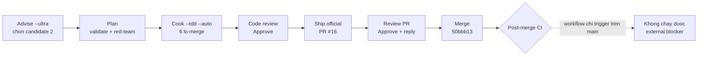

# Vibe Completion Report — Microstructure Type-File Consolidation

Date: 2026-10-25
Repo: `minhlongs/cashclaw-trading-bot`
Branch: `feat/quantlib-microstructure-type-consolidation`
Worktree: `/Users/macbook/trade-bot-worktrees/microstructure-type-consolidation`
Plan: `cashclaw-trading-bot/261024-1346` (closed)
Issue: #14
PR: #16 — **MERGED**, merge commit `50bbb13`
Ship mode: `official` (target `baseline/wave10-consolidation`)

## Vibe Result

Pipeline chạy từ intake tới merge. Kết quả cuối: **157 file thay đổi, +3.857 / −1.199**, toàn bộ
nằm trong phạm vi đã thống nhất. Không deploy production.

| Bước | Trạng thái |
|---|---|
| Worktree / branch | Skiped — đã chạy trong worktree riồng sẵn trên đúng feature branch |
| Investigate (research / debug) | Skipped — refactor thuần, không phát hiện library mới, không có bug cần chứng minh nguyên nhân |
| Plan + gates | Plan có sẵn; `validate` + `red-team` đã chạy, 1 finding Important đã áp dụng |
| Implement (`/ak:cook --tdd --auto`) | Done — 6 lô merge, mỗi lô 1 commit revert được |
| Review (`/ak:code-review --pending`) | Done — Approve |
| Test | Skipped — coverage từ `--tdd` đã đủ; 2 test file cho script là deliverable của chính plan |
| Docs | Skipped ở chế độ official (do `/ak:ship official` quản lý); ghi nhận trong PR |
| Ship PR | Done — PR #16 |
| Review/fix/reply PR | Done — verdict Approve, đã trả lời trên PR |
| Merge + CI | **Merged.** Post-merge CI không chạy được — blocker ngoài repo PR |

## Journey Diagram



## Implementation Summary

Gộp 57 file `*-types.ts` chỉ có đúng một production importer vào module engine/queue tiêu thụ
duy nhất, giảm `src/tree/quantlib/microstructure/` từ **132 file production xuống 75**.

Toàn bộ được gate bằng bộ đếm importer (`scripts/count-type-importers.mjs`) thay vì danh sách
viết tay: chỉ cho phép stem qua cổng khi có đúng một production importer, so khớp **chính xác
tên basename**. 6 stem bị chặn và để nguyên: `abdi-ranaldo`, `corwin-schultz`,
`gatheral-transient-impact`, `hawkes-jump`, `kyle-obizhaeva-invariance`, `roll-spread`.

Script merge (`scripts/merge-microstructure-types.mjs`) nối khối type vào consumer rồi xoá câu
import. Nối văn bản an toàn vì cả 57 file type đều thuần `interface`/`type`/`enum` — đã kiểm
chứng **0 value export** trên toàn bộ 57 file. 144 khai báo export được đối chiếu lại trên commit
đã merge: **0 thiếu, 0 treo**.

## Kiểm chứng ở đúng commit đã merge

| Tiêu chí | Lệnh | Kết quả |
|---|---|---|
| 132 → 75 file production | `find src/tree/quantlib/microstructure -name '*.ts' ! -name '*.test.*' \| wc -l` | **75** |
| Còn đúng 6 file `-types.ts` bị chặn | so tên từng file với bảng gate | **khớp** |
| Không file nào vượt 120 LOC | `awk '$1>120 && $2!="total"'` | rỗng; lớn nhất **103** |
| `public-sdk.ts` không đổi | `git diff b7aba5f..50bbb13 -- public-sdk.ts \| wc -l` | **0** |
| Type-check | `npm run type-check` | exit 0 |
| Lint | `npm run lint -- --max-warnings 0` | exit 0 |
| Full suite | `npm test` | **722 file / 6.028 test**, 0 fail |
| Không phát sinh debt | `npx knip` | 3 file / 44 export — bằng baseline |
| Không mất khai báo | 57 file xoá × 144 export đối chiếu trên `50bbb13` | 0 thiếu, 0 treo |

11 specifier `-types` còn lại trong `microstructure` đều hợp lệ: đó là 6 file bị chặn và chính
consumer của chúng, không phải import treo.

## Plan Deviations

**D1 — biên độ thay đổi ở test layer là 703 dòng trên toàn range**, vượt ngưỡng 50 của plan. Nguyên
nhân: range còn chứa 441 dòng của 2 test file mà phase 1–2 tự thêm. Giới hạn đúng ở 25 file
consumer bị merge trỏ lại: **100 dòng** (50 xoá + 50 thêm), đúng 2 dòng mỗi file, **0 dòng** chứa
`expect(`, `describe(`, `it(` hay assertion. Không test nào bị làm yếu.

**D2 — suite là 722 file / 6.028 test**, không phải 720 / 6.003. 2 file của phase 1–2 vốn là test
nên suite lớn thêm 2 file và 25 case. Cả 6.003 test baseline cũ vẫn pass.

Không có lệch trên tiêu chí chính: **75 file production**, khớp dự đoán của plan.

## Subagent Quality Assessment

Không có subagent delegate nào — mọi kiểm chứng chạy trực tiếp trong session này.

Code review: **0 Critical / 0 Important / 1 Minor — 1/1 đã xử lý trong branch.**

Minor 1 là lỗi tôi tự chẩn đoán rồi tự sửa giữa phiên: ban đầu tôi cho rằng guard
"self-contained statement" ở `merge-microstructure-types.mjs:55` là chỗ chưa được test. Trace
chứng minh nó **không tạo ra tác động quan sát được**; thứ thực sự đóng đường lỗi là **post-merge
specifier scan ở dòng 177**. Report và test đều được viết lại để pin đúng cơ chế thật. Test mới
được xác minh hai chiều: xanh trên code không bị đụng, và là case fail duy nhất khi xoá post-merge
scan.

Bốn probe mutation xác nhận guard quan trọng thật sự có test phủ: bỏ `test/` khỏi scan roots bắt
bởi 2 assertion, bỏ backward statement walk bắt bởi 5, tắt trần 120 LOC bắt bởi 1.

## CI Status

**2 check đỏ trên PR #16, cả hai đều có từ trước.** Bằng chứng đo được:

- **Open-Core gate** ("Verify zero .claude / .agentkit / .env tracked in git"): có 46 file như vậy
  được track, và con số là **46 ở baseline `b7aba5f` lẫn 46 ở HEAD**. Diff này thêm và xoá **0**
  file thuộc nhóm đó.
- **`ci` step "ESLint suppressions baseline check"**: số lượng eslint-disable trong `src/` là 4 ở
  cả baseline lẫn HEAD; diff thêm và xoá **0** dòng. Baseline trong `eslint-suppressions.json` đã
  lệch từ trước đợt này.

**Post-merge CI trên base branch: không chạy được.** Đây là blocker ngoài phạm vi PR. Cả hai
workflow chỉ trigger trên `main`:

```yaml
on:
  push:
    branches: [main]
  pull_request:
    branches: [main]
```

Merge vào `baseline/wave10-consolidation` vì thế **không kích hoạt một run CI nào**. Đổi `on:` là
thay đổi cấu hình CI của repo, không thuộc phạm vi gộp file type.

`build` và `test:coverage` **không chạy được** trong session này do cấu hình tool chặn; hai bước
này giao cho CI.

## Human Next Steps

1. **Deploy production chưa làm.** `--deploy` không phải flag có tài liệu trong ak-vibe, và không
   workflow nào của repo này chứa job deploy. Nếu muốn deploy `50bbb13`, cần xác nhận rõ ràng —
   đây là hành động không hoàn tác và hướng ra ngoài.
2. **`origin/main` đang ở `688fb76` (v3), tụt 84 commit sau `baseline/wave10-consolidation`.** Bộ
   v7–v14 chưa từng tới remote default branch. Không có gì được push lên `main` hay force-push.
3. **Sửa 2 gate CI đã lệch từ trước**: gate hygiene `.claude/` và baseline `eslint-suppressions.json`.
   Cả hai cần thay đổi riêng, không thuộc phạm vi refactor vừa merge.
4. **Mở CI cho branch baseline** nếu `baseline/wave10-consolidation` sẽ tiếp tục là target của PR.
5. **Follow-up refactor** (chưa làm, ghi nhận cho sau): `src/tree/quantlib/execution/` có cùng hình
   dạng (khoảng 37 file type). Ngoài microstructure còn 154 file `*-types.ts`, trong đó **13 chứa
   value export** (ví dụ class kế thừa `Error`) nên cần di chuyển bằng AST chứ không nối văn bản
   được.
6. **Cải thiện gợi ý cho lần sau**: `findImportStatement` nên khớp dòng vừa chứa specifier vừa mở
   bằng `import`/`export`, để loại trường hợp prose ngay từ gốc thay vì ở bước sau.

## Unresolved questions

- Có nên deploy production `50bbb13` không? Tôi không tự quyết vì `--deploy` không phải flag được
  skill định nghĩa.
- `baseline/wave10-consolidation` là target chính thức hay chỉ là branch tạm để review? Nếu chỉ là
  tạm, toàn bộ 84 commit cần lên `main` bằng cách nào vẫn chưa rõ.
- 46 file `.claude/` được track là chủ ý (chúng nằm sẵn ở baseline và repo có `.ckignore` riêng) hay
  cần untrack? Đây là quyết định của bạn về hygiene của repo, nên nó phình ở trong lúc refactor.
